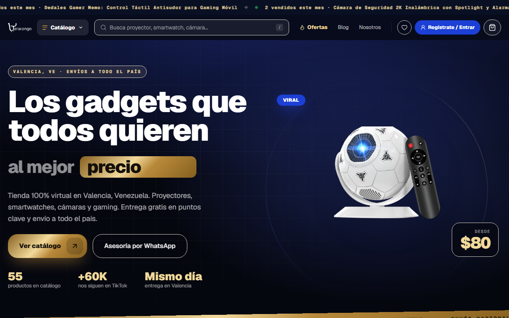
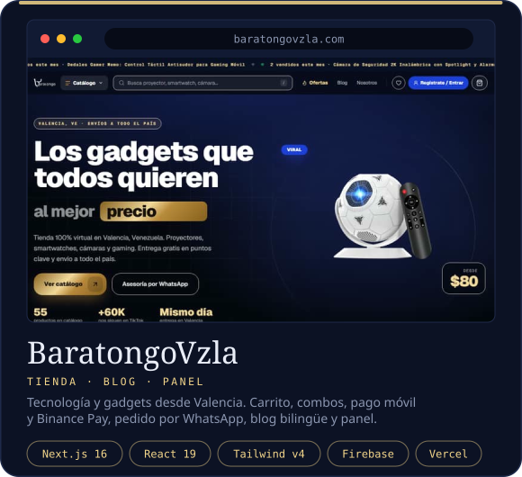
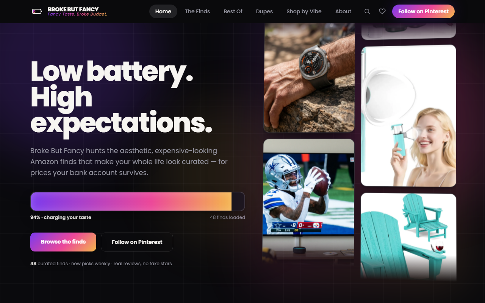
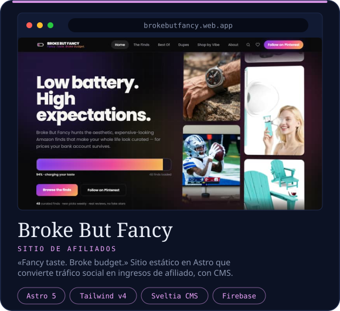
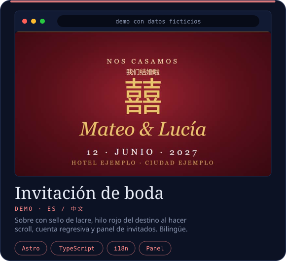
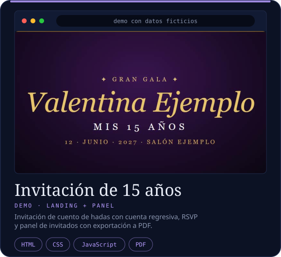

 

---

## 👋 Hola, soy Jonathan

**CTO de [BaratongoVzla](https://baratongovzla.com)**, desde Valencia, Venezuela. Construyo tiendas, blogs y paneles de administración que cargan rápido, posicionan en Google y se pagan solos.

Mi trabajo es convertir ideas en sitios que funcionan de verdad: pagos con Pago Móvil, pedidos por WhatsApp, sitios bilingües, invitaciones de boda con sello de lacre y cuenta regresiva. Sí, también eso.

> 💬 *«Funciona en mi máquina.»* — y en producción también. Casi siempre.
>
> ☕ *Café → código → deploy → «¿por qué se cayó?» → más café.*
>
> 🕵️ *1,088 contribuciones en el último año y 0 repos públicos. Mis commits son privados; mis bugs, también.*
>
> 🧠 *CTO = Chief Tinkering Officer. Si no lo rompí hoy, todavía no lo probé.*

 

---

## 🧰 Stack

---

## 🚀 Proyectos

<table>
<tr>
<td width="50%" valign="top" align="center">

<a href="https://baratongovzla.com"><b>🌐 Visitar baratongovzla.com →</b></a> &nbsp;·&nbsp; <a href="assets/previews/baratongovzla.png"><b>🖼️ Ver captura completa</b></a>
</td>
<td width="50%" valign="top" align="center">

<a href="https://brokebutfancy.web.app"><b>🌐 Visitar brokebutfancy.web.app →</b></a> &nbsp;·&nbsp; <a href="assets/previews/brokebutfancy.png"><b>🖼️ Ver captura completa</b></a>
</td>
</tr>
<tr>
<td width="50%" valign="top" align="center">

<a href="https://johngeek2024.github.io/demo-boda/"><b>🎭 Ver demo (datos ficticios) →</b></a>
</td>
<td width="50%" valign="top" align="center">

<a href="https://johngeek2024.github.io/demo-15/"><b>🎭 Ver demo (datos ficticios) →</b></a>
</td>
</tr>
</table>

> 🖼️ Las capturas viven en este perfil: si un sitio se cae, la vista previa sigue aquí. 🎭 Las invitaciones son demos con datos ficticios, no los sitios reales. 🔒 El código es privado. Si quieres ver cómo trabajamos, escríbeme.

---

## 🐍 Contribuciones

 

