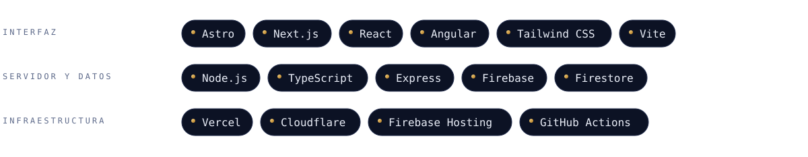

 

 

Soy el CTO de [BaratongoVzla](https://baratongovzla.com), en Valencia, Venezuela. Construyo tiendas, blogs y paneles de administración que cargan rápido, posicionan en Google y se pagan solos.

Mi trabajo es que las ideas funcionen de verdad: Pago Móvil, pedidos por WhatsApp, sitios bilingües e invitaciones de boda con sello de lacre y cuenta regresiva. Sí, también eso.

> «Funciona en mi máquina.» Y en producción también. Casi siempre.
>
> Café, código, deploy, «¿por qué se cayó?», más café.
>
> CTO: Chief Tinkering Officer. Si hoy no rompí nada, es que todavía no lo probé.

<b>Cómo trabajo</b>

 

- **Primero rápido.** Sitios estáticos cuando se puede, imágenes optimizadas y nada de dependencias de más.
- **SEO técnico de serie.** Sitemap, datos estructurados, RSS y `llms.txt` para los buscadores con IA.
- **Pensado para Venezuela.** Pago Móvil, Binance Pay y cierre del pedido por WhatsApp.
- **Bilingüe por defecto.** Español, inglés y chino en los sitios que lo necesitan.
- **Cada proyecto con su panel.** Pedidos, ventas, invitados o contenido, según el caso.
- **Seguridad antes que adornos.** Reglas de base de datos con pruebas, demos con datos ficticios y código privado.

<b>English summary</b>

 

CTO at BaratongoVzla (Valencia, Venezuela). I build e-commerce sites, blogs and admin panels with Astro, Next.js, TypeScript and Firebase. My sites are bilingual (Spanish, English, Chinese), built around local payment flows (Pago Móvil, Binance Pay) and WhatsApp order handling, with technical SEO included. I'm also an Amazon Influencer (@BaratongoVzla). Source code is private; the invitation projects below have public demos with fictional data.

 

 

 

 

<table>
<tr>
<td width="50%" valign="top" align="center">

<a href="https://baratongovzla.com"><b>Visitar baratongovzla.com</b></a>
</td>
<td width="50%" valign="top" align="center">

<a href="https://brokebutfancy.web.app"><b>Visitar brokebutfancy.web.app</b></a>
</td>
</tr>
<tr>
<td width="50%" valign="top" align="center">

<a href="https://johngeek2024.github.io/demo-boda/"><b>Ver demo (datos ficticios)</b></a>
</td>
<td width="50%" valign="top" align="center">

<a href="https://johngeek2024.github.io/demo-15/"><b>Ver demo (datos ficticios)</b></a>
</td>
</tr>
</table>

Las invitaciones son demos con datos ficticios, no los sitios reales. El código es privado.

 

 

