


<a href="https://www.linkedin.com/in/jonathan-moreno-03101988/"></a>

 


Soy cofundador y CTO de [BaratongoVzla](https://baratongovzla.com), en Valencia, Venezuela. Construyo tiendas, blogs y paneles de administración que cargan rápido, posicionan en Google y se pagan solos.

Mi trabajo es que las ideas funcionen de verdad: Pago Móvil, pedidos por WhatsApp, sitios bilingües e invitaciones de boda con sello de lacre y cuenta regresiva. Sí, también eso.


<b>English summary</b>

 

Co-founder and CTO at BaratongoVzla (Valencia, Venezuela). I build e-commerce sites, blogs and admin panels with Astro, Next.js, TypeScript and Firebase. My sites are bilingual (Spanish, English, Chinese), built around local payment flows (Pago Móvil, Binance Pay) and WhatsApp order handling, with technical SEO included. I'm also an Amazon Influencer (@BaratongoVzla). Source code is private; the invitation projects below have public demos with fictional data.

 


<a href="https://baratongovzla.com"></a>
<a href="https://brokebutfancy.web.app"></a>

<a href="https://johngeek2024.github.io/demo-boda/"></a>
<a href="https://johngeek2024.github.io/demo-15/"></a>

Las invitaciones son demos con datos ficticios, no los sitios reales. El código es privado.

 


  

 

