 

**Hago videos que venden gadgets. Lo demás es consecuencia.**

Soy John Moreno, creador de contenido de tecnología y cofundador de [BaratongoVzla](https://baratongovzla.com), en Valencia, Venezuela. Llevo más de 70 videos de producto y uno de ellos, el del proyector que convirtió mi techo en un cine 4K, pasó de 1,3 millones de vistas. Eso se explica con un buen producto, un gancho de tres segundos y gente a la que le encanta ver un techo convertido en cine.

Mi método es simple: cuento lo que el producto hace de verdad, sin humo, y con el humor justo para que veas el video completo. Un video aburrido es un anuncio que nadie pidió.

Si eres una marca de tecnología, puedo hacerte el video que tu producto merece. Si solo vienes a mirar, lo que las marcas no te dicen lo cuento en mis redes. Y sí, también programo la tienda; pero eso es el dato curioso, no el titular.

<b>English summary</b>

 

Tech and gadgets content creator, and co-founder and CTO of BaratongoVzla (Valencia, Venezuela). I've made 70+ product videos, one of them with 1.3M views. I explain what a product really does, in neutral Latin American Spanish, with humor and no hype. I'm also an Amazon Influencer (@BaratongoVzla) and I build the store's website myself. Open to UGC work with tech brands; the invitation projects below have public demos with fictional data.

 

Las invitaciones son demos con datos ficticios, no los sitios reales. El código es privado.

 

Además de construir tiendas, hago contenido en video: reseñas y demos de gadgets, tecnología e IA con humor y datos reales, en español neutro para toda Latinoamérica. ¿Tu marca de tecnología necesita un video que explique el producto de verdad? [Escríbeme por LinkedIn](https://www.linkedin.com/in/jonathan-moreno-03101988/) o por [Instagram](https://www.instagram.com/SoyJohnMoreno).

 

  

 

